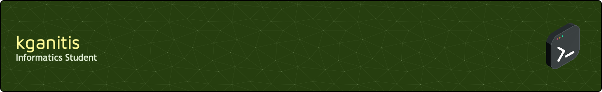

<!--
**kganitis/kganitis** is a ✨ _special_ ✨ repository because its `README.md` (this file) appears on your GitHub profile.
-->
<!---->

### Present

- **Tour operations platform** (private client, .NET 9): LLM-based support-ticket triage with Azure OpenAI + Semantic Kernel, ERP bridge for booking management, and an MCP server exposing domain tools to AI agents. ASP.NET Core, PostgreSQL, SignalR, Docker, Azure DevOps CI/CD.
- **[BAM Engine](https://github.com/kganitis/bam-engine)**: agent-based macroeconomics in Python. Simulates households, firms, and banks across labor, credit, and goods markets on a vectorized, ECS-inspired NumPy core. MSc thesis project.

### Past
- **Public-Sector Payroll System**: backend developer on a thick-database Oracle stack, maintaining and extending a payroll system for a large government organization, originally built circa 2005. All payroll logic implemented in PL/SQL on Oracle Database, with an Oracle Forms front-end.
- **Internal Security Tooling**: developed in-house tools for the cybersecurity department of a large organization, supporting security monitoring, technical security assessments, and information security compliance workflows.

### Future

- **Handmade game development** (C++): building games from scratch with custom engines — data-oriented design, arena-based memory, and ownership of every line.

### Academic Background

- MSc Informatics, University of Piraeus
- BSc Economic Sciences, Aristotle University of Thessaloniki
